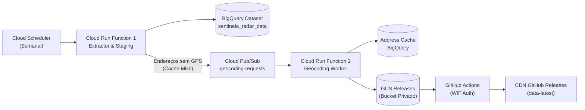

# Sentinela Data Pipeline 🛰️

[](https://github.com/thcborges/sentinela-data-pipeline/actions/workflows/ci.yml)
[](https://www.python.org/downloads/release/python-3120/)
[](https://cloud.google.com/bigquery)
[](https://pytest.org)

Pipeline de dados em Python 3.12 e Lakehouse no Google Cloud Platform (GCP) para extração massiva, geocodificação inteligente com cache e consolidação de pontos de fiscalização eletrônica (radares fixos e móveis, semáforos, lombadas físicas/eletrônicas e pedágios) em todo o Brasil.

Alimenta tanto o dataset público no **Google BigQuery** quanto as compilações SQLite espaciais (**R\*Tree**) distribuídas para o aplicativo móvel [Sentinela Radar](https://github.com/thcborges/sentinela-radar).

---

## 📊 Acesso Público aos Dados no BigQuery

Todas as bases brutas e consolidadas estão disponíveis publicamente para leitura no **Google BigQuery** no projeto **`thcb-sentinela-radar`** e dataset **`sentinela_radar_data`**.

### 💡 Modelo de Custo Zero para o Mantenedor
O dataset concede a role `roles/bigquery.dataViewer` para `allAuthenticatedUsers`, porém o projeto **não** concede permissão pública de execução de jobs (`roles/bigquery.jobUser`).
* **Como funciona:** Você pode consultar todas as tabelas livremente utilizando o **seu próprio projeto GCP** como faturador do processamento (`billing_project_id`).
* O mantenedor paga apenas pela hospedagem e você utiliza sua própria cota gratuita mensal do BigQuery (1 TB/mês de consultas gratuitas no GCP).

---

### 💻 Como Consultar os Dados

#### 1. Via Google Cloud SDK CLI (`bq`)
Substitua `MEU_PROJETO_GCP` pelo ID do seu projeto no GCP:

```bash
bq query \
  --use_legacy_sql=false \
  --billing_project_id=MEU_PROJETO_GCP \
  "SELECT poi_type, COUNT(*) as total
   FROM \`thcb-sentinela-radar.sentinela_radar_data.pois_consolidated_snapshot\`
   WHERE snapshot_date = CURRENT_DATE()
   GROUP BY poi_type
   ORDER BY total DESC;"
```

#### 2. Via Python SDK (`google-cloud-bigquery`)
```python
from google.cloud import bigquery

# Inicializa o cliente apontando para o SEU projeto de faturamento
client = bigquery.Client(project="MEU_PROJETO_GCP")

query = """
    SELECT poi_id, poi_type, latitude, longitude, speed_limit, road_name, city, uf
    FROM `thcb-sentinela-radar.sentinela_radar_data.pois_consolidated_snapshot`
    WHERE uf = 'SP' AND poi_type = 'FIXED_RADAR'
    LIMIT 10;
"""

df = client.query(query).to_dataframe()
print(df.head())
```

#### 3. Via BigQuery Web Console
1. Acesse o [BigQuery Console](https://console.cloud.google.com/bigquery).
2. Certifique-se de que o seu projeto pessoal/corporativo está selecionado no topo.
3. No painel do Explorer, clique em **+ ADICIONAR DADOS** ➔ **Fixar projeto pelo nome** ➔ Digite: `thcb-sentinela-radar`.
4. O dataset `sentinela_radar_data` aparecerá no menu lateral pronto para consultas SQL.

---

### 🗄️ Tabelas Disponíveis

| Tabela | Particionamento | Descrição |
| :--- | :--- | :--- |
| **`pois_consolidated_snapshot`** | Diário (`snapshot_date`) | Snapshot semanal consolidado, deduplicado (<35m) e enriquecido com GPS. |
| **`address_geocoding_cache`** | Não particionada (Clusterizada por hash) | Cache permanente de endereços geocodificados (OpenStreetMap e Google Maps). |
| **`raw_antt_pedagios`** | Diário (`ingestion_date`) | Dados brutos de praças de pedágio e tarifas da ANTT. |
| **`raw_antt_radares`** | Diário (`ingestion_date`) | Dados brutos de radares em rodovias federais concedidas da ANTT. |
| **`raw_prf_radares`** | Diário (`ingestion_date`) | Dados brutos de radares oficiais da Polícia Rodoviária Federal. |
| **`raw_dnit_pncv`** | Diário (`ingestion_date`) | Dados brutos do Plano Nacional de Controle de Velocidade do DNIT. |
| **`raw_nacional_aberto`** | Diário (`ingestion_date`) | Dados estaduais e municipais de 27 UFs (OpenClaw / Inmetro). |
| **`raw_osm_comunitario`** | Diário (`ingestion_date`) | Dados comunitários higienizados do OpenStreetMap. |

---

## 🏗️ Arquitetura Resumida



---

## 🚀 Desenvolvimento Local e Testes

### Pré-requisitos
* Python 3.12+

### Instalação
```bash
git clone git@github.com:thcborges/sentinela-data-pipeline.git
cd sentinela-data-pipeline
python3 -m venv .venv
source .venv/bin/activate
pip install -e ".[dev]"
```

### Executar Testes com Cobertura (≥ 90%)
```bash
pytest --cov=sentinela_pipeline --cov-report=term-missing --cov-fail-under=90
```

### Linting e Tipagem
```bash
ruff check .
ruff format --check .
mypy src/
```

---

## 📚 Documentação Completa (`docs/`)

Para guias detalhados sobre cada aspecto do projeto, consulte a pasta [`docs/`](docs/index.md):

* 🏛️ [**Arquitetura do Sistema**](docs/architecture.md): Detalhamento dos componentes GCP, concorrência e tempo ocioso.
* 💾 [**Modelagem e BigQuery**](docs/bigquery-datasets.md): Dicionário de dados, particionamento e rotina de retenção mensal após 90 dias.
* 📍 [**Pipeline de Geocodificação**](docs/geocoding-pipeline.md): Heurísticas de normalização, rate-limit do OSM e fallback do Google Maps.
* ☁️ [**Infraestrutura com Terraform**](docs/terraform-gcp.md): Provisionamento em `us-central1`, Workload Identity Federation e IAM.
* 📱 [**Integração com Sentinela App**](docs/mobile-integration.md): Compilação SQLite R\*Tree, bucket GCS e espelhamento na CDN.
* 🛠️ [**Guia de Desenvolvimento e CI/CD**](docs/development.md): Setup local, esteiras de testes e deploy contínuo.

---

## 📄 Licença
Distribuído sob a licença MIT. Consulte `LICENSE` para obter mais detalhes.
