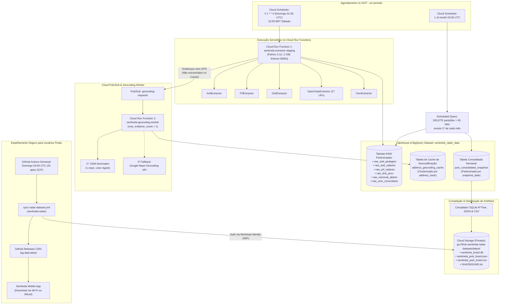

# Arquitetura do Sistema: Sentinela Data Pipeline 🏛️

## 1. Visão Geral e Contexto

O **Sentinela Data Pipeline** opera como a espinha dorsal de inteligência geoespacial do ecossistema Sentinela. O aplicativo móvel é estritamente *100% offline-first* e não executa chamadas pesadas de rede durante a condução do veículo. Cabe a este pipeline em nuvem coletar, higienizar, geocodificar e compilar a base nacional de radares, publicando-a de forma versionada.

---

## 2. Diagrama de Fluxo e Componentes GCP

---

## 3. Decisões Arquiteturais Fundamentais

### 3.1. Duas Cloud Run Functions Desacopladas via Pub/Sub
* **Problema:** A extração das 27 UFs do cadastro nacional identifica milhares de radares cadastrados pelo Inmetro que possuem endereço/logradouro, mas não latitude e longitude. A geocodificação no OpenStreetMap Nominatim exige estritamente um intervalo mínimo de 1 segundo entre requisições. Tentar geocodificar todos os pontos dentro de uma única execução linear geraria timeouts de função e risco de esgotamento de memória.
* **Solução:**
  1. A **Function 1 (`sentinela-extractor-staging`)** executa aos domingos às 01:00 UTC. Ela extrai os dados das APIs oficiais, grava as tabelas RAW particionadas no BigQuery, consulta o cache de endereços já resolvidos e publica mensagens individuais no Pub/Sub `geocoding-requests` apenas para os endereços pendentes.
  2. A **Function 2 (`sentinela-geocoding-worker`)** consome a fila do Pub/Sub. Configurada com `max_instance_count = 1`, ela garante serialização rigorosa das requisições para respeitar a cota do Nominatim (1 req/s), preenchendo a tabela permanente `address_geocoding_cache`.

### 3.2. Otimização do Tempo Ocioso de Extração
Durante a paginação das 27 UFs pela API do OpenClaw, pequenas pausas de cooldown e latências de rede ocorrem naturalmente.
O pipeline utiliza processamento assíncrono para que, a cada página de dados recebida contendo endereços não geocodificados, esses registros sejam imediatamente normalizados, verificados contra o cache em memória e despachados para o Pub/Sub sem bloquear o loop de extração.

### 3.3. Snapshot Semanal e Limpeza de Radares Inexistentes
Em vez de depender de flags manuais de status que podem ficar desatualizadas nos órgãos emissores, cada extração semanal captura um **snapshot completo** da malha viária ativa.
* Radares desativados ou removidos pelas concessionárias deixam de figurar na tabela consolidada mais recente.
* A rastreabilidade histórica é mantida íntegra, pois todas as partições anteriores permanecem arquivadas no BigQuery.
