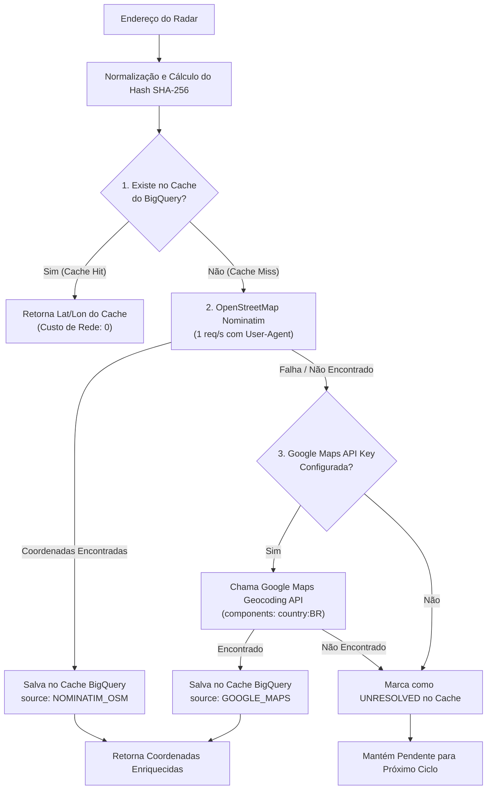

# Pipeline de Geocodificação e Cache Inteligente 📍

## 1. O Desafio dos Radares sem Coordenadas

No Brasil, os órgãos de fiscalização de trânsito (Inmetro, DERs, CETs e prefeituras) registram aferições de instrumentos com endereços textuais (ex: *"Av. das Américas, altura do nº 500, Barra da Tijuca, Rio de Janeiro - RJ"* ou *"Rodovia BR-116, km 205, Arujá - SP"*), muitas vezes sem o registro das coordenadas de latitude e longitude.

No ecossistema Sentinela, instrumentos sem GPS são inúteis para o motorista, pois o motor matemático de alertas exige cálculo de distância euclidiana/Haversine e rumo (*bearing*).

---

## 2. Estratégia Multi-Tier de Resolução

O `GeocoderService` opera em três níveis rigorosos para maximizar a assertividade e minimizar os custos:

---

## 3. Algoritmo de Normalização de Endereços

Antes de qualquer consulta ou cálculo de hash, o endereço passa por normalização determinística:
1. **Decomposição Unicode (NFKD):** Separa letras de acentos diacríticos (ex: `é` ➔ `e` + `´`).
2. **Remoção de Pontuação:** Substitui vírgulas, hífens, barras e caracteres especiais por espaços.
3. **Colapso de Espaços e Caixa Alta:** Converte todo o texto para maiúsculas e remove espaços repetidos.

### Exemplo:
* **Entrada bruta:** `  Av. das Américas, nº 500 - Bloco 2 / Barra da Tijuca, Rio de Janeiro - RJ! `
* **Texto normalizado:** `AV DAS AMERICAS NO 500 BLOCO 2 BARRA DA TIJUCA RIO DE JANEIRO RJ`
* **Hash SHA-256:** `4d9f78a0c23e8e9...`

---

## 4. Política de Rate-Limit no OpenStreetMap Nominatim

O OpenStreetMap disponibiliza o serviço de busca Nominatim de forma aberta e gratuita, exigindo o cumprimento rígido de sua política de uso (*Nominatim Usage Policy*):
* **Frequência Máxima:** Máximo de **1 requisição por segundo** (intervalo mínimo de 1.000 ms).
* **Identificação Obrigatória:** Header `User-Agent` contendo a identidade do projeto e link do repositório:
  `SentinelaRadarDataPipeline/1.0 (+https://github.com/thcborges/sentinela-data-pipeline)`
* **Proibição de Threads Concorrentes:** No GCP, a Cloud Run Function `sentinela-geocoding-worker` possui `max_instance_count = 1` configurada via Terraform, garantindo que não existam múltiplos containers disputando a API simultaneamente.

---

## 5. Fallback Controlado para Google Maps Geocoding

Quando o OpenStreetMap não localiza o endereço (frequente em marcos quilométricos de rodovias federais ou estaduais):
* O sistema aciona a **Google Maps Geocoding API**.
* Cada conta do Google Cloud possui uma cota mensal gratuita de **US$ 200** (equivalente a ~40.000 requisições/mês sem custo adicional).
* O Terraform permite configurar alertas de orçamento no Cloud Billing para garantir que nenhum custo exceda o planejado.
