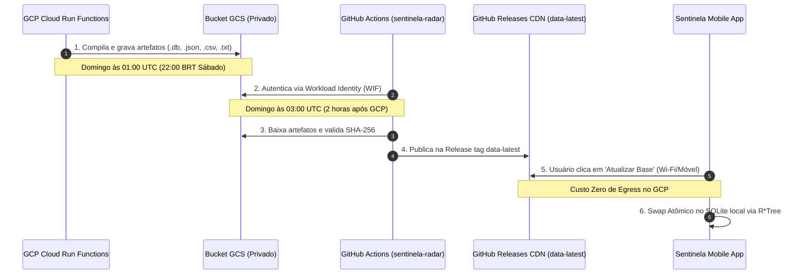

# Integração com o Aplicativo Móvel Sentinela 📱

## 1. Princípio 100% Offline-First e Isolamento de Rede

O aplicativo móvel **Sentinela Radar** (disponível para Android e iOS) adota como pilar inegociável a operação **100% offline-first**. 
* Durante as viagens do motorista, o aplicativo **não** faz requisições ao GCP, **não** consulta o BigQuery e **não** transmite coordenadas de telemetria.
* Toda a tomada de decisão em tempo real (sonar, distâncias dinâmicas e alertas de excesso de velocidade) ocorre consultando o banco SQLite local compilado com extensão espacial nativa **R\*Tree**.

---

## 2. Artefatos Compilados

O pipeline compila semanalmente quatro artefatos canônicos no diretório de saída do bucket privado (`gs://thcb-sentinela-radar-datasets/latest/`):

1. **`sentinela_brasil.db`:**
   * Banco SQLite 3 com extensão espacial **R\*Tree** nativa.
   * Tabela `pois`: registros normalizados com tipos semânticos, velocidade, rumo e tarifas de pedágio.
   * Tabela `pois_index`: índice espacial virtual R\*Tree `(id, minX, maxX, minY, maxY)`.
   * Tabela `db_metadata`: chave-valor com timestamp UTC, total de pontos e versão de schema.
2. **`sentinela_pois_brasil.json`:**
   * Arquivo JSON padronizado com nó raiz `elements`, consumível diretamente pelo parser interno do aplicativo (`PoiSyncParser`).
3. **`sentinela_pois_brasil.csv`:**
   * Tabela tabular em CSV para análise de dados, conferência e interoperabilidade com SIGs (QGIS, ArcGIS).
4. **`SHA256SUMS.txt`:**
   * Checksums criptográficos SHA-256 de cada arquivo para validação de integridade antes do swap atômico no celular.

---

## 3. Fluxo de Sincronização e Espelhamento na CDN

---

## 4. Vantagens Estratégicas do Modelo

* **Custo Zero de Tráfego de Saída:** O download massivo de milhares de motoristas é absorvido integralmente pela rede CDN global e gratuita do GitHub.
* **Segurança Total:** O bucket do Google Cloud Storage permanece 100% privado, sem necessidade de chaves de API ou tokens embutidos no APK/IPA.
* **Resiliência:** Se o GCP estiver em manutenção, a última base válida permanece disponível no GitHub Releases.
